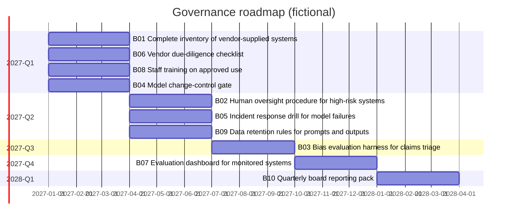

# Roadmap (generated; fictional company, synthetic data)

Capacity per quarter: 12 effort points.

quarter | load | items
2027-Q1 | 11/12 | B01 Complete inventory of vendor-supplied systems; B06 Vendor due-diligence checklist; B08 Staff training on approved use; B04 Model change-control gate
2027-Q2 | 11/12 | B02 Human oversight procedure for high-risk systems; B05 Incident response drill for model failures; B09 Data retention rules for prompts and outputs
2027-Q3 | 8/12 | B03 Bias evaluation harness for claims triage
2027-Q4 | 6/12 | B07 Evaluation dashboard for monitored systems
2028-Q1 | 3/12 | B10 Quarterly board reporting pack

